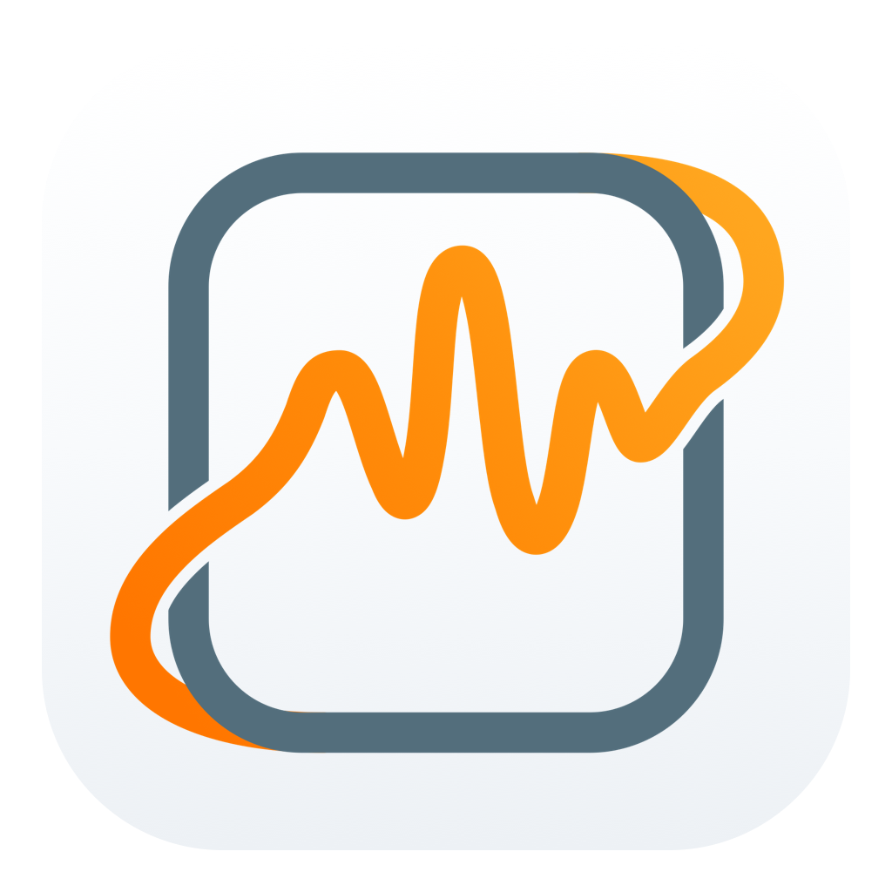

  

<h1 align="center">VoiceHotkey</h1>

<strong>ショートカットを押して話すだけで、macOSに入力</strong>

  <a href="https://github.com/yeahhe365/VoiceHotkey-releases/releases/latest"><strong>最新版をダウンロード</strong></a> ·
  <a href="https://voicehotkey.pages.dev/docs/ja/getting-started/install/">インストールガイド</a>

**言語：** [简体中文](README.md) · [繁體中文](README.zh-Hant.md) · [English](README.en.md) · 日本語 · [한국어](README.ko.md) · [Deutsch](README.de.md) · [Español](README.es.md)

> **現在の公開版：0.9.4**
> **Apple Silicon（arm64）Mac、macOS 14 以降**に対応。現在 Intel 用インストーラーはありません。[最新版をダウンロード](https://github.com/yeahhe365/VoiceHotkey-releases/releases/latest)。
> このインストーラーは **Apple の公証を受けておらず、Apple Developer ID で署名されていません**。初回起動が macOS にブロックされる場合があります。0.9.3 のインストーラーは公開を取り下げました。最新版をご利用ください。

[VoiceHotkey](https://voicehotkey.pages.dev/) の**公式インストーラー / ダウンロード**リポジトリです。

> **インストーラーは [GitHub Releases](https://github.com/yeahhe365/VoiceHotkey-releases/releases) のみで公開されます。**
> 本リポジトリの git 履歴に `.dmg` / `.app` などのバイナリはコミットしません。

## 製品について

macOS の**音声入力**：ホットキーを長押し、またはタップして話すと、認識後のテキストをカーソル位置に挿入します。端末内モデル、クラウド認識、音声コマンド、翻訳・文章推敲、ファイル文字起こし、ローカル履歴に対応。

  

- **製品サイト：** [voicehotkey.pages.dev](https://voicehotkey.pages.dev/)
- **ユーザーハンドブック：** [voicehotkey.pages.dev/docs](https://voicehotkey.pages.dev/docs/ja/)
- **主な機能：**
  - **マルチ認識エンジン**：Apple システム音声、デバイス内オフラインモデル（Qwen3-ASR、SenseVoice、Whisper CoreML/ANE 加速、MOSS-0.9B、FireRed、Fun-ASR、Parakeet）、Doubao ASR 2.0、百錬、小米 MiMo、Azure、クラウド Whisper、Groq、ElevenLabs Scribe、Soniox、NVIDIA NIM、Gemini など
  - **テキスト処理**：学習した高頻度フレーズで LLM リクエストを省略でき、正規表現や文脈に応じた単語置換、任意の LLM 推敲、Apple ネイティブ翻訳に対応（Apple 翻訳は macOS 26+、言語リソースが必要な場合あり）。
  - **音声コマンドと操作**：ローカル辞書と意図解釈 LLM によるショートカットキー入力、テキスト展開、ショートカットアプリ連携、制御されたシステム操作（任意のシェル実行は非搭載）
  - **ファイル文字起こしと書き出し**：試用 / Pro では音声・動画ファイルを文字起こしし、`.srt` / `.vtt` / `.ass` / `.lrc` 字幕または `.txt` テキストを出力できます。
  - **プライバシー設定**：API キーは macOS Keychain に保管。ローカル限定モードは外部 ASR / LLM エンドポイントを制限し更新を停止しますが、ライセンスリクエストと手動モデルダウンロードは通信できます。[データの送信先](https://voicehotkey.pages.dev/docs/ja/privacy/local-only/)。
- **UI 言語**（アプリと同一）：简体中文、繁體中文、English、日本語、한국어、Deutsch、Español

## ダウンロード

| | |
|--|--|
| **最新バージョン** | [Releases · Latest](https://github.com/yeahhe365/VoiceHotkey-releases/releases/latest) |
| **すべてのバージョン** | [Releases](https://github.com/yeahhe365/VoiceHotkey-releases/releases) |
| **製品サイト** | [voicehotkey.pages.dev](https://voicehotkey.pages.dev/) |
| **ハンドブック** | [ドキュメント](https://voicehotkey.pages.dev/docs/ja/) |
| **サポート** | [お問い合わせ](https://voicehotkey.pages.dev/docs/ja/support/contact/) |

### 推奨インストール手順

1. Apple Silicon Mac と macOS 14 以降であることを確認し、[最新 Release](https://github.com/yeahhe365/VoiceHotkey-releases/releases/latest) を開きます。
2. `VoiceHotkey-0.9.4.dmg` をダウンロードします。Source code アーカイブはインストーラーではありません。
3. **VoiceHotkey.app** を **アプリケーション**（`/Applications` または `~/Applications`）にドラッグし、インストール先の固定パスから起動します。
4. macOS が起動をブロックした場合は公式配布元を確認し、[Apple の案内](https://support.apple.com/ja-jp/102445)に従います。破損の警告ならチェックサムを確認して再ダウンロードし、解決しなければサポートへ連絡してください。
5. 初回設定で **アクセシビリティ**、**マイク**、既定の Apple エンジン用の **音声認識** を許可します。
6. 初回設定の練習欄をクリックし、既定の **Ctrl + Option + Space** で一文を話して、テキストが挿入されることを確認します。

任意：インストール前に Release 説明の SHA-256 チェックサムを確認してください。詳しい手順は [インストールガイド](https://voicehotkey.pages.dev/docs/ja/getting-started/install/) をご覧ください。

**初回利用：** 既定の Apple 音声認識は API キー不要です。macOS 26+ の新エンジンでは言語リソースのダウンロードが必要な場合があります。旧システムの Apple Speech の通常モードは Apple のサービスを利用する場合があります。独立した端末内モデルは事前にインストールしてください。クラウド認識と LLM 機能の認証情報や API 利用料金は、選択したサービスに従います。

**試用とライセンス：** 初回起動でカード登録不要の 14 日間 Pro 試用が開始し、終了後も Free を利用できます。Pro の初回アクティベーションとキー変更にはオンライン確認が必要です。確認後は最大 30 日間オフラインで利用でき、個人ライセンスは最大 3 台の Mac に対応します。[ライセンス詳細](https://voicehotkey.pages.dev/docs/ja/support/license/)。

詳細：[アップデート](https://voicehotkey.pages.dev/docs/ja/advanced/updates/)。

## ライセンスと条項

VoiceHotkey はプロプライエタリ商用ソフトウェアです。本リポジトリではアプリのソースコードを公開していません。インストーラーの入手は、製品ライセンス / 利用規約を超える権利を与えません。
本リポジトリの [LICENSE](LICENSE) · [NOTICE](NOTICE.md)、および [プランと商用](https://voicehotkey.pages.dev/docs/ja/getting-started/plans/)、[プライバシーポリシー](https://voicehotkey.pages.dev/docs/ja/privacy/policy/) をご覧ください。

## サポート

- 不具合・使い方 → [お問い合わせ](https://voicehotkey.pages.dev/docs/ja/support/contact/)
- ダウンロードリンク切れ・アセット欠落 → 本リポジトリの [Discussions](https://github.com/yeahhe365/VoiceHotkey-releases/discussions) に投稿
- 本リポジトリは**配布専用**です。機能要望などはハンドブックのお問い合わせ窓口をご利用ください
